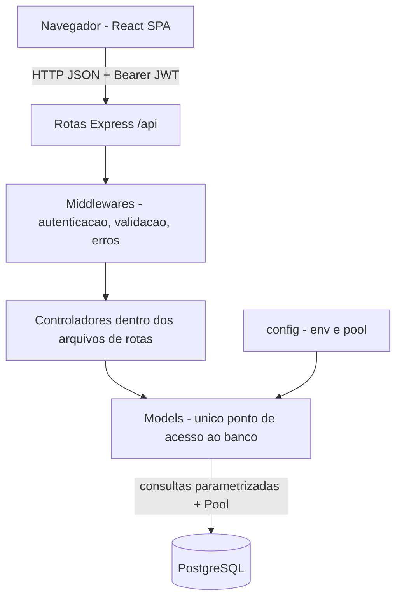
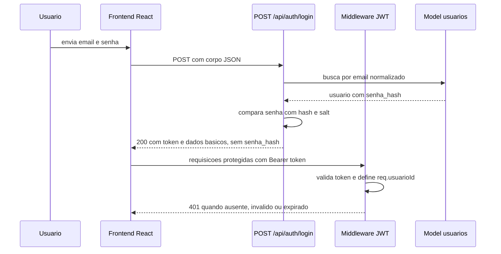

# Proposta Técnica — Projeto 2 Full Stack

**Disciplina:** Programação Web Full Stack — Engenharia de Software
**Projeto:** Aplicação de Controle Financeiro Pessoal
**Integrantes:** Igor (back-end) e Rafael (front-end)
**Documento de referência:** `PLANO_MESTRE_PROJETO.md`
**Status:** aguardando aprovação do professor — nenhuma dependência foi instalada e nenhum código de aplicação foi escrito.

> Documento de apoio. Não substitui o `PLANO_MESTRE_PROJETO.md` nem o enunciado do professor. Nada aqui autoriza implementação antes da aprovação formal.

---

## 1. Objetivo deste documento

1. Apresentar de forma objetiva as tecnologias que pretendemos usar no Projeto 2.
2. Justificar cada escolha com critério técnico e com o requisito do enunciado que ela atende.
3. Deixar explícito o que depende de aprovação do professor.
4. Servir de base para a mensagem de solicitação de aprovação (seção 10).
5. Registrar as decisões para a Issue "Registrar aprovação do banco e bibliotecas" e para a seção 1.2 do plano mestre.

Nada foi instalado, configurado ou versionado. O `.gitignore`, o `README.md` e as Issues permanecem intocados.

---

## 2. Resumo da recomendação

| Camada | Recomendação | Situação |
|---|---|---|
| Banco de dados | PostgreSQL 16 (instância local) | **Aguardando aprovação** |
| Driver de banco | `pg` com Pool de conexões e SQL puro | **Aguardando aprovação** |
| Migrations | Scripts SQL versionados em `backend/database/migrations` | Decisão interna (ferramenta não obrigatória) |
| Servidor HTTP | `express` | Aguardando aprovação |
| Hash de senha | `bcryptjs` (pure JS, salt embutido) | **Aguardando aprovação** |
| Token | `jsonwebtoken` | **Aguardando aprovação** |
| Rate limiting | `express-rate-limit` | **Aguardando aprovação** |
| CORS | `cors` | Aguardando aprovação |
| Variáveis de ambiente | `dotenv` | Aguardando aprovação |
| Validação de entrada | Validadores próprios (CPF, e-mail, cartão, valores) | Decisão interna (sem biblioteca extra) |
| Testes back-end | `node:test` nativo + `supertest` | Decisão interna (sem framework extra) |
| Front-end | React + Vite | Exigido pelo enunciado |
| Roteamento | `react-router-dom` | Aguardando aprovação |
| Cliente HTTP | `fetch` encapsulado em um único módulo | Decisão interna (sem `axios`) |
| Gráficos | `recharts` | **Aguardando aprovação** |
| Representação de dinheiro | `NUMERIC(14,2)` no banco + aritmética em centavos inteiros no servidor | **Aguardando aprovação** |

Nenhuma biblioteca fora desta lista será adicionada sem nova consulta ao professor.

---

## 3. Banco de dados

### 3.1 Opções permitidas pelo enunciado

O enunciado aceita PostgreSQL, MySQL ou MongoDB. Comparação considerando as regras do projeto: integridade referencial, `UNIQUE` composto, `CHECK`, transação no parcelamento, agregações de relatório no servidor e valor monetário exato.

| Critério | PostgreSQL | MySQL | MongoDB |
|---|---|---|---|
| Dinheiro exato | `NUMERIC(14,2)` nativo | `DECIMAL(14,2)` nativo | `Decimal128`, exige cuidado manual |
| Integridade referencial | FK completas, `CHECK` reais | FK completas, `CHECK` a partir do 8.0.16 | Sem FK; validação só na aplicação |
| Unicidade composta (nome por usuário e tipo) | Índice único simples de declarar | Índice único simples de declarar | Índice composto, sem vínculo com schema |
| Transação no parcelamento | `BEGIN/COMMIT/ROLLBACK` robusto | Suportado (InnoDB) | Transações multi-documento exigem replica set |
| Relatórios com GROUP BY e SUM | Excelente, com `FILTER`, `date_trunc` | Bom, sintaxe de datas menos expressiva | Aggregation pipeline, mais complexo de explicar |
| Facilidade de instalação no Windows | Instalador oficial simples | Instalador oficial simples | Fácil, mas sem ganho para este domínio |
| Alinhamento com o domínio | Alto — dados fortemente relacionais | Alto | Baixo — o modelo é relacional por natureza |

### 3.2 Recomendação

**PostgreSQL 16, instância local, acessada apenas pelo back-end.**

Motivos:

1. O modelo do projeto é explicitamente relacional: `usuarios`, `categorias`, `fontes_destinos`, `lancamentos`, com FKs e regras de unicidade. Um banco relacional representa isso sem gambiarra.
2. O plano mestre exige que a unicidade de e-mail e CPF seja garantida pelo banco, e não apenas por consulta prévia no código. Em PostgreSQL isso é `UNIQUE` real, inclusive sobre e-mail normalizado e CPF só com dígitos.
3. O plano mestre exige que o parcelamento seja transacional. PostgreSQL garante tudo-ou-nada de forma direta e fácil de demonstrar na apresentação.
4. Os relatórios exigem agregação no servidor. `GROUP BY`, `SUM` e filtros por período em SQL são mais simples de explicar do que um pipeline de agregação do MongoDB.
5. `NUMERIC` resolve a proibição de `float` para dinheiro sem depender de biblioteca decimal.
6. É o banco com que Igor tem mais facilidade de demonstrar criação de schema por script na apresentação.

### 3.3 Como será provisionado

- Instância local do PostgreSQL, criada por script, sem depender de serviço externo (a demonstração deve funcionar sem internet).
- Banco único do projeto, por exemplo `projeto2_financas`.
- Scripts SQL versionados em `backend/database/migrations` (DDL com FKs, `CHECK`, `UNIQUE`, índices) e `backend/database/seed`.
- Credenciais somente em `.env`, com `.env.example` sem segredos.
- Acesso ao banco exclusivamente em `backend/src/models`, sempre com consultas parametrizadas e pool de conexões.

### 3.4 Perguntas ao professor sobre o banco

1. PostgreSQL é aceito como banco do projeto?
2. A instância local é suficiente, ou é exigido banco em nuvem?
3. É exigido ORM, ou SQL puro com driver `pg` é aceitável?
4. Scripts SQL de migration são aceitos como entrega, ou é exigida ferramenta de migration específica?

---

## 4. Representação de valores monetários

Requisito do plano: nunca usar `float` para dinheiro, e o parcelamento precisa fechar exatamente, com a diferença de arredondamento na primeira parcela.

### Opções

| Opção | Vantagens | Desvantagens |
|---|---|---|
| **A. `NUMERIC(14,2)` no banco, aritmética em centavos inteiros no servidor** | Valor exato no banco; divisão de parcelas sem erro porque a conta é feita em inteiros e só depois convertida; leitura humana direta no banco | Exige conversão explícita na camada de modelo e validação de casas decimais na entrada |
| B. Coluna `valor_centavos BIGINT` | Aritmética 100% inteira do início ao fim | Menos legível no banco e nos relatórios; exige conversão em toda API |
| C. `DECIMAL` + biblioteca decimal no Node | Precisão garantida em todas as operações | Uma biblioteca adicional para aprovar; `pg` já retorna `NUMERIC` como string |

### Recomendação

**Opção A.** O banco guarda `NUMERIC(14,2)`; toda soma, divisão de parcelas e comparação é feita em centavos inteiros no back-end; a API devolve reais com duas casas. Isso atende os dois lados: precisão no armazenamento e segurança aritmética no parcelamento (R$ 100,00 em 3x gera R$ 33,34 + R$ 33,33 + R$ 33,33, somando exatamente R$ 100,00).

Decisão precisa ser registrada no plano mestre e aprovada pelo professor.

---

## 5. Bibliotecas do back-end

Versões de referência no momento da escrita; a versão estável no ato da instalação será registrada no plano mestre.

| Biblioteca | Versão de referência | Para quê | Obrigatória? | Alternativa |
|---|---|---|---|---|
| `express` | 4.x | Servidor HTTP e rotas | Sim (exigida pelo enunciado) | — |
| `pg` | 8.x | Driver PostgreSQL com Pool | Sim, se PostgreSQL for aprovado | `mysql2` se MySQL for aprovado |
| `bcryptjs` | 3.x | Hash de senha com salt, sem dependência nativa | Sim | `bcrypt` (nativo, mais rápido, exige build no Windows) ou `argon2` |
| `jsonwebtoken` | 9.x | Geração e validação de JWT | Sim (JWT é exigido) | `jose` |
| `express-rate-limit` | 7.x | Limite de tentativas no login | Sim (exigido na seção 9 do plano) | Limitação manual em memória |
| `cors` | 2.x | Restringir origem do front-end | Sim | Middleware próprio de cabeçalhos |
| `dotenv` | 16.x | Carregar `.env` fora do Git | Sim | Variáveis do sistema operacional |
| `nodemon` (dev) | 3.x | Reinício automático em desenvolvimento | Não, mas recomendada | `node --watch` nativo |
| `supertest` (dev) | 7.x | Testes de integração dos endpoints | Recomendada | Chamadas HTTP manuais |
| `helmet` (opcional) | 8.x | Cabeçalhos HTTP de segurança | Não | Proteção manual |

Testes usam `node:test` nativo do Node, sem framework adicional.

### Justificativas relevantes

- **`bcryptjs` em vez de `bcrypt`:** é JavaScript puro, não exige compilador C++ nem Visual Studio Build Tools no Windows, o que evita falha de instalação na máquina do Igor e na do Rafael. Continua entregando hash com salt, que é o requisito. O custo de desempenho é irrelevante para um projeto acadêmico. Se o professor preferir `bcrypt` nativo ou `argon2`, é troca simples na camada de model de usuário.
- **`jsonwebtoken`:** API estável e direta para `sign` e `verify` com expiração, além de ser a biblioteca mais fácil de explicar na apresentação.
- **Sem ORM:** o plano exige consultas parametrizadas e pool de conexões explicitamente. SQL puro com `pg` mostra isso de forma verificável e mantém as regras de negócio no back-end, não escondidas em mágica de ORM.
- **Sem biblioteca de validação:** as regras de CPF, e-mail, cartão e valores precisam ser explícitas e explicáveis. Validadores próprios ficam em `middlewares` e nas rotas, sem dependência extra para aprovar. Se o professor exigir `zod` ou `express-validator`, adaptamos antes da Fase 2.
- **Sem `morgan`:** logs de requisição podem expor dados sensíveis se mal configurados. Se o professor quiser log de requisição, usamos uma configuração restrita, sem corpo e sem cabeçalhos de autenticação.

---

## 6. Bibliotecas do front-end

Responsável pela instalação: Rafael. As aprovações devem ser pedidas ao professor de uma vez, para não travar o front-end depois.

| Biblioteca | Para quê | Obrigatória? | Alternativa |
|---|---|---|---|
| `react` + `react-dom` | SPA | Sim (exigida) | — |
| `vite` | Build e dev server | Sim (exigido) | — |
| `react-router-dom` | Navegação e rotas protegidas | Sim, na prática | Roteamento manual |
| `recharts` | Gráficos de relatórios | Sim, se os relatórios exigirem gráfico | `chart.js` |
| `eslint` + plugins React (dev) | Qualidade de código | Recomendada | — |

Decisões internas do front-end, que não precisam de aprovação do professor: cliente HTTP único com `fetch` encapsulado, token em `localStorage`, formatação com `Intl.NumberFormat` em `pt-BR`, edição coordenada do `README.md` com Igor.

---

## 7. Arquitetura proposta

### 7.1 Visão geral



Regras que a arquitetura garante:

- O front-end nunca acessa o banco.
- Toda validação, autorização, isolamento por usuário, agregação e cálculo de fatura acontece no back-end.
- O `usuario_id` vem sempre do JWT, nunca do corpo ou da URL.
- Valores monetários nunca passam por `float` no armazenamento.

### 7.2 Estrutura de pastas prevista

```text
projeto2-fullstack/
├── backend/
│   ├── package.json
│   ├── .env.example
│   ├── database/
│   │   ├── migrations/
│   │   └── seed/
│   └── src/
│       ├── server.js
│       ├── routes/
│       ├── models/
│       ├── middlewares/
│       └── config/
└── frontend/
    ├── package.json
    └── src/
        ├── components/
        ├── contexts/
        └── services/
```

Não existirá `backend/src/controllers`. Os controladores ficam nos arquivos de rotas, conforme o enunciado.

### 7.3 Camadas e responsabilidades

| Camada | Responsabilidade | Restrições |
|---|---|---|
| `routes/` | Definição das rotas, controladores, reaproveitamento de validações | Nunca acessa o banco diretamente |
| `middlewares/` | Autenticação JWT, validação de entrada, tratamento centralizado de erros, rate limit | Sem regra de negócio duplicada da camada de models |
| `models/` | Único ponto de SQL, consultas parametrizadas, transações | Nenhuma resposta HTTP |
| `config/` | Pool de conexão e leitura de variáveis de ambiente | Sem segredos versionados |
| `database/` | DDL/migrations e seed | Executável pela linha de comando |

### 7.4 Fluxo de autenticação



### 7.5 Padrão de resposta e de erro

- Sucesso: JSON com os dados.
- Erro padronizado:

```json
{
  "erro": "Dados inválidos.",
  "campos": {
    "valor": "O valor deve ser maior que zero."
  }
}
```

- Códigos: `400` validação, `401` autenticação, `404` inexistente ou de outro usuário, `409` conflito de unicidade ou exclusão bloqueada, `500` erro inesperado sem vazar detalhes.
- Banco usa `snake_case`; JSON usa `camelCase`; a conversão acontece nos models.

---

## 8. Pontos que exigem aprovação do professor

Marque cada item quando houver resposta formal:

- [ ] PostgreSQL como banco do projeto.
- [ ] Instância local do PostgreSQL é suficiente.
- [ ] Uso do driver `pg` com SQL puro e Pool de conexões, sem ORM.
- [ ] Scripts SQL de DDL/migration como entrega de modelagem.
- [ ] `bcryptjs` para hash com salt.
- [ ] `jsonwebtoken` para JWT.
- [ ] `express-rate-limit` no login.
- [ ] `cors` restrito à origem do front-end.
- [ ] `dotenv` para variáveis de ambiente.
- [ ] Validadores próprios, sem biblioteca de validação.
- [ ] `node:test` + `supertest` para testes do back-end.
- [ ] `helmet`: usar ou dispensar.
- [ ] `recharts` para gráficos no front-end.
- [ ] `react-router-dom` para navegação.
- [ ] Representação de dinheiro em `NUMERIC(14,2)` com aritmética em centavos.
- [ ] Seed com 2 usuários e 3 meses de lançamentos, conforme o enunciado.
- [ ] Desafio opcional de saúde financeira: pode ser feito depois, sem impactar a nota base.
- [ ] Critério de entrega: repositório único com back-end e front-end, sem deploy obrigatório.

---

## 9. Riscos e mitigação

| Risco | Impacto | Mitigação |
|---|---|---|
| Professor não aprovar PostgreSQL | Retrabalho de modelagem | Comparação da seção 3.1 pronta; MySQL é o plano B com mudança pequena (`mysql2` e ajustes de DDL) |
| Exigência de ORM | Reescrita da camada de models | Perguntar antes; se exigido, usar ORM apenas em models, mantendo regras fora dele |
| `bcrypt` nativo exigido | Falha de instalação no Windows | Trocar para `bcrypt` com prebuilt ou `argon2`, decidindo antes da Fase 3 |
| Aprovação demorada | Front-end sem contrato | Publicar o contrato da API em documentação antes dos endpoints; Rafael usa mocks temporários e os remove na integração |
| Divergência de contrato entre os dois | Retrabalho | Contrato documentado antes da implementação e aviso formal a cada mudança |
| Vazamento de `AGENTS.md` ou `PLANO_MESTRE_PROJETO.md` | Violação de regra do grupo | Corrigir `.gitignore` como primeiro item após o diagnóstico |

---

## 10. Mensagem pronta para enviar ao professor

```text
Assunto: Projeto 2 — Aplicação Full Stack de Controle Financeiro — solicitação de aprovação de banco e bibliotecas

Professor,

Somos Igor e Rafael, do grupo do Projeto 2 (Aplicação Full Stack de Controle Financeiro Pessoal).
Antes de iniciar a implementação, queremos confirmar as escolhas de banco de dados e bibliotecas,
conforme entendemos ser exigência da disciplina.

1) Banco de dados
   Escolha pretendida: PostgreSQL, instância local, acessada somente pelo back-end.
   Modelagem: quatro entidades (usuarios, categorias, fontes_destinos, lancamentos), com chaves
   estrangeiras, restrições UNIQUE para e-mail e CPF, CHECK para tipos e valores, índice para
   consultas de lançamentos por usuário e período.
   Acesso: driver pg com Pool de conexões, SQL puro e consultas parametrizadas, sem ORM.
   Modelagem entregue por scripts SQL versionados no repositório.
   Valores monetários em NUMERIC(14,2), com aritmética em centavos no servidor para o parcelamento.

   Perguntamos: o PostgreSQL é aceito? A instância local é suficiente ou é exigido banco em nuvem?
   SQL puro com driver é aceitável ou o senhor exige ORM? Scripts SQL de migração são aceitos
   como entrega?

2) Back-end (Node.js + Express)
   Bibliotecas pretendidas:
   - express
   - pg
   - bcryptjs (hash de senha com salt, JavaScript puro, sem dependência de compilador)
   - jsonwebtoken (JWT com expiração)
   - express-rate-limit (limite de tentativas no login)
   - cors (restrito à origem do front-end)
   - dotenv (variáveis de ambiente; .env fora do Git)
   - nodemon e supertest apenas em desenvolvimento
   - testes com node:test nativo do Node
   Validação de entrada feita por validadores próprios, sem biblioteca adicional.

   Perguntamos: existe alguma biblioteca acima que o senhor não aceita? O senhor prefere bcrypt
   nativo ou argon2 em vez de bcryptjs? Podemos usar node:test em vez de Jest? Recomenda helmet?

3) Front-end (React SPA com Vite)
   Bibliotecas pretendidas:
   - react e react-dom
   - vite
   - react-router-dom
   - recharts (gráficos dos relatórios)
   - eslint apenas em desenvolvimento
   Cliente HTTP único com fetch, token em localStorage, formatação de moeda com Intl em pt-BR.

   Perguntamos: recharts e react-router-dom estão aprovados? Há preferência por outra biblioteca
   de gráficos?

4) Organização
   Repositório único com pastas backend e frontend. Dentro de backend/src teremos apenas server.js
   e as pastas routes, models, middlewares e config, sem pasta controllers, conforme a estrutura
   exigida. Todo acesso ao banco ficará em models, com consultas parametrizadas. As regras de
   negócio, o isolamento por usuário e os cálculos de relatórios e faturas ficarão no back-end.
   O seed terá dois usuários e três meses de lançamentos.

5) Desafio opcional
   Pretendemos implementar a página de saúde financeira apenas depois de concluir e testar todos
   os requisitos obrigatórios, com cálculos no servidor e aviso educativo na interface.

Aguardo sua confirmação para registrar as decisões na documentação do projeto e iniciar a
implementação. Obrigado.

Igor e Rafael
```

---

## 11. Próximos passos após a aprovação

1. Registrar as decisões aprovadas na seção 1.2 do `PLANO_MESTRE_PROJETO.md` e atualizar a seção 17.
2. Concluir o diagnóstico do Git/GitHub com as saídas reais dos comandos.
3. Corrigir o `.gitignore` para proteger `AGENTS.md` e `PLANO_MESTRE_PROJETO.md`.
4. Reescrever o `README.md` inicial, em coordenação com Rafael.
5. Criar as Issues 1 e 2 e as labels do repositório.
6. Publicar o contrato da API antes de qualquer endpoint.
7. Iniciar a Fase 1 somente com as bibliotecas aprovadas.

Enquanto a aprovação e o diagnóstico não estiverem resolvidos, nenhuma linha de código de aplicação será escrita.
